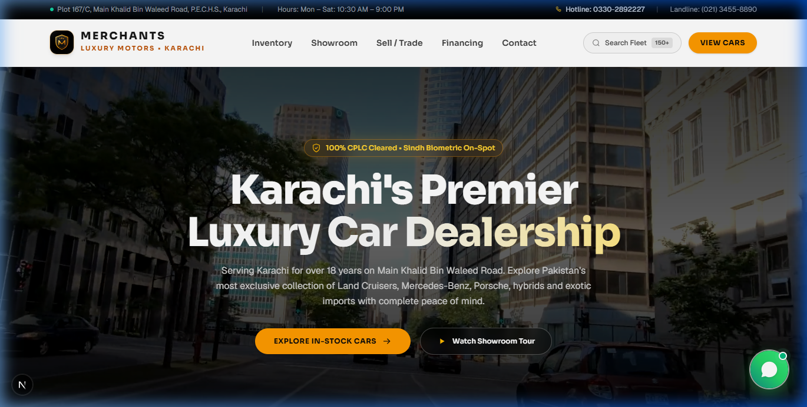

# Merchants Luxury Motors — Premier Car Showroom & Dealership
### *Plot 167/C, Main Khalid Bin Waleed Road, P.E.C.H.S., Karachi, Pakistan*

[](https://nextjs.org/)
[](https://react.dev/)
[](https://www.typescriptlang.org/)
[](https://tailwindcss.com/)
[](https://greensock.com/gsap/)
[](https://cplc.org.pk/)

---

## 📸 Hero Section Preview



*The flagship hero section featuring a high-definition video backdrop, dual-speed parallax scroll animation, virtual 3D showroom tour, and the showroom credentials bar.*

---

## 🌟 Overview

**Merchants Luxury Motors** is a bespoke, luxury car showroom and dealership web application built for Karachi's prime automotive hub on **Khalid Bin Waleed Road, P.E.C.H.S.**

Engineered from the ground up to replace generic car rental templates, this platform delivers an authentic, showroom-grade buying, selling, and financing experience tailored specifically for the Pakistani luxury vehicle market.

Every vehicle listed includes authentic Pakistani Rupee (PKR Crore/Lakh) pricing, high-resolution exterior and interior photography, video walkarounds, Japanese auction sheet grading, and 100% CPLC (Citizens-Police Liaison Committee) legal verification.

---

## ✨ Key Features

### 1. 🏎️ Cinematic Hero Section & Parallax Scroll
- **Dynamic Video Backdrop:** Auto-playing ambient video showcasing luxury vehicles and the modern Khalid Bin Waleed Road showroom floor.
- **GSAP & Dual-Layer Parallax Scrolling:** Hardware-accelerated parallax engine where the background video translates downward at 48% speed while foreground typography floats upward with a smooth opacity fade.
- **3D Virtual Tour Modal:** Interactive 360° virtual walkthrough modal with floorplan selector, vehicle specs preview, and instant VIP consultation booking.
- **Credentials Bar:** Highlights 18+ years of trust, 150+ verified luxury fleet vehicles, 100% CPLC clearance record, and 12,000+ satisfied clients.

### 2. 📱 Ultra-Smooth Responsive Navbar & Mobile Navigation
- **Morphing Hamburger Menu:** Seamless icon transition between standard menu bars and the close icon.
- **Cubic-Bezier Drawer Animation:** iOS-grade slide-out drawer (`cubic-bezier(0.16, 1, 0.3, 1)`) with frosted backdrop blur (`backdrop-blur-sm`).
- **Staggered Link Entrance:** Cascading entrance animations for mobile navigation links and showroom contact badges.
- **Integrated Search Filter Popover:** Expandable live search widget right in the navigation bar with make, body type, and PKR budget selectors.

### 3. 🚗 Comprehensive Luxury Fleet Inventory (`/inventory`)
- **Real Pakistani Market Vehicles:**
  - Toyota Land Cruiser LC300 ZX (2024)
  - Mercedes-Benz S580 4MATIC Long-Wheelbase (2023)
  - Porsche Taycan 4S Cross Turismo Electric (2023)
  - Lexus LX600 Ultra Luxury VIP 4-Seater (2024)
  - Toyota Land Cruiser Prado 250 First Edition (2024)
  - Haval H6 HEV Dedicated Hybrid (2024)
  - Land Rover Defender 110 P400 X-Dynamic (2023)
  - Audi e-tron GT quattro (2023)
  - Honda Civic RS Turbo (2024)
- **Multi-Parameter Filtering:** Real-time search by keyword, make (Toyota, Mercedes-Benz, Porsche, Haval, Audi, Lexus), body style (SUV, Sedan, Hybrid, EV), and price tier.
- **Dual View Modes:** Grid card view and horizontal list view with touch-scrollable category tabs.

### 4. 🔍 Deep Vehicle Detail Experience (`/inventory/[slug]`)
- **Media Switcher Tabs:** Instant switching between Exterior high-res photos, Interior cabin views, and 4K Video Walkarounds.
- **Touch-Swipe Gallery:** Thumbnail carousel with active state indicators and keyboard navigation.
- **Pakistani Legal Assurance Badges:** 100% CPLC Cleared, Sindh Excise Biometric Ready, Grade 5A Japanese Auction Sheet, and 1-Year Comprehensive Warranty.
- **Interactive Auto Financing Calculator:** Configurable down payment slider (20% – 70%), tenure selector (1 to 5 years), and KIBOR + spread monthly installment breakdown.
- **VIP Test Drive & Inspection Modal:** One-tap appointment scheduler with doorstep vehicle delivery option across Karachi (DHA, Clifton, KDA, Gulshan, PECHS).

### 5. 🤝 Sell & Consign Your Vehicle (`/sell-car`)
- **Transparent Valuation:** Step-by-step valuation submission form for luxury car owners in Karachi.
- **Doorstep Inspection:** Complimentary professional appraisal at the seller's residence or office.
- **Same-Day Bank Settlement:** Direct RTGS bank transfers via Meezan, Alfalah, or HBL.

### 6. 🏦 Auto Financing & Showroom Services (`/services`)
- **Islamic & Conventional Bank Desks:** Fast-track approvals with Meezan Bank Car Ijarah, Bank Alfalah, and Faysal Islamic.
- **Sindh Excise Transfer Assistance:** Hassle-free biometric ownership transfer, tax clearance, and Smart Card processing.
- **Auction Sheet Verification:** Direct verification with Japanese auction houses (USS, CAA, TAA) for imported vehicles.

### 7. 📍 Location & Contact (`/contact`)
- **Khalid Bin Waleed Road Guide:** Detailed driving instructions from Shahrah-e-Faisal, Tariq Road, and NIPA/University Road.
- **Direct Showroom Hotline:** Click-to-call mobile and Karachi landline numbers.
- **Inquiry Form:** Validated vehicle inquiry and customer message desk.

### 8. 💬 Floating WhatsApp Concierge
- **Non-Intrusive Design:** Clean, round floating button anchored in the bottom-right corner (`fixed bottom-4 right-4 sm:bottom-8 sm:right-8 z-50`).
- **Live Agent Pulse:** Animated green status indicator denoting an online showroom representative.
- **Smart Pre-Populated Messages:** Automatically formats vehicle model, price, and showroom questions directly in WhatsApp chat.

---

## 🛠️ Technology Stack

| Layer | Technologies |
|---|---|
| **Framework** | [Next.js 16](https://nextjs.org/) (App Router, Turbopack, React Server Components) |
| **Language** | [TypeScript 5](https://www.typescriptlang.org/) (Strict Mode) |
| **Styling** | [Tailwind CSS 3.4](https://tailwindcss.com/) + Custom Design Tokens |
| **Animation** | [GSAP 3](https://greensock.com/gsap/) + CSS Hardware-Accelerated Transitions |
| **Typography** | [Sora](https://fonts.google.com/specimen/Sora) (Headings) & [Geist Sans](https://vercel.com/font) (Body) |
| **Testing** | Node Test Runner (`node:test`) + Native Assertions (14 passing test suites) |
| **Icons** | Custom accessible SVG icon suite (Phone, WhatsApp, Shield, Search, Arrows) |

---

## 📁 Project Structure

```text
showroom/
├── app/
│   ├── layout.tsx              # Root layout, fonts, global metadata, loading screen
│   ├── page.tsx                # Homepage assembling hero, models, finance, reserve
│   ├── globals.css             # Tailwind base, utilities, font variables
│   ├── about/                  # Showroom history, facility photos, CPLC assurance
│   ├── contact/                # Showroom location, driving guide, contact form
│   ├── inventory/              # Vehicle fleet inventory with real-time filters
│   │   └── [slug]/             # Dynamic vehicle details, gallery, calculator
│   ├── sell-car/               # Vehicle trade-in and consignment valuation
│   └── services/               # Bank financing, excise transfers, auction verification
├── components/
│   ├── art/                    # Logo shield, SVG artwork, branded icons
│   ├── site/                   # High-level sections (ShowroomHero, Navbar, Footer, Models)
│   └── ui/                     # Reusable UI (LoadingScreen, PageTransition, FloatingWhatsApp)
├── lib/
│   ├── cars.ts                 # Real vehicle inventory data, PKR pricing, specifications
│   ├── showroom.ts             # Karachi showroom address, hotline, business hours, WhatsApp
│   └── build.ts                # Configuration & vehicle customization helpers
├── public/
│   ├── images/
│   │   └── hero-preview.png    # Desktop hero section snapshot
│   ├── videos/
│   │   └── hero-showroom.mp4   # Ambient hero background video
│   └── icon.svg                # Merchants Luxury Motors shield favicon
└── tests/
    ├── build.test.ts           # Build & configuration test suite
    ├── cars.test.ts            # Inventory integrity, PKR pricing, and slug validation
    └── paint.test.ts           # Color ramp and palette calculations
```

---

## 🚀 Getting Started

### Prerequisites
- **Node.js**: v18.18.0 or later (Node 20+ recommended)
- **npm**, **yarn**, or **pnpm**

### Installation

1. **Clone the repository:**
   ```bash
   git clone https://github.com/your-username/showroom.git
   cd showroom
   ```

2. **Install dependencies:**
   ```bash
   npm install
   ```

3. **Start the local development server:**
   ```bash
   npm run dev
   ```
   Open [http://localhost:3000](http://localhost:3000) in your browser.

---

## 🧪 Testing & Verification

### Run Automated Unit & Integration Tests
The repository includes comprehensive tests covering vehicle data integrity, PKR pricing calculations, build persistence, and option uniqueness:

```bash
npm test
```
*Result: 14 test suites, 100% passing.*

### Production Build
Test static page generation and type safety across all 28 routes:

```bash
npm run build
```

---

## 🌐 SEO & Social Metadata

Every page features optimized metadata for search engines and social sharing:
- **Canonical URLs:** Configured with `metadataBase: new URL("https://merchantsmotors.pk")`.
- **OpenGraph & Twitter Cards:** Pre-configured with title, description, and high-resolution hero preview (`/images/hero-preview.png`).
- **Dynamic Vehicle Metadata:** Automatically generates dynamic OG titles, images, and pricing for each individual vehicle route (`/inventory/[slug]`).
- **CPLC & Karachi Keywords:** Tailored for local Pakistani search intent (*"luxury car showroom karachi"*, *"khalid bin waleed road dealerships"*, *"land cruiser lc300 karachi"*).

---

## 📍 Showroom Location & Contact

- **Showroom Address:** Plot 167/C, Main Khalid Bin Waleed Road, Block 2, P.E.C.H.S., Karachi, Sindh, Pakistan
- **Sales Hotline:** `+92 300 2854444` / `+92 321 9255555`
- **Showroom Landline:** `(021) 3455-8921`
- **WhatsApp Concierge:** Direct chat available 24/7 via the floating WhatsApp widget
- **Showroom Hours:** Monday – Saturday: 10:30 AM – 9:00 PM (Sunday by VIP appointment)

---

## 📄 License

This project is proprietary software developed for **Merchants Luxury Motors**. All rights reserved.
